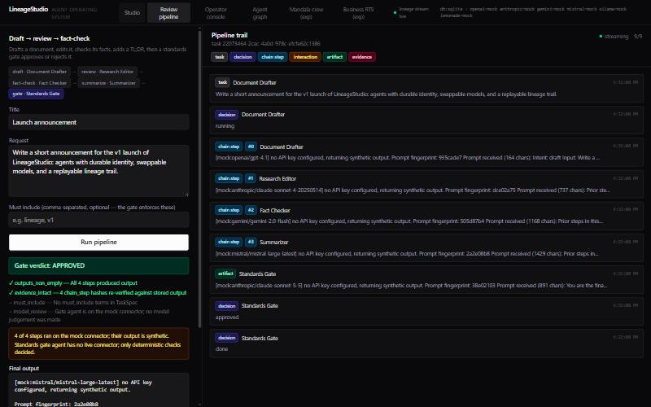

# LineageStudio

Lineage-driven multi-model **agent operating system**. Agents own role and lineage; connectors and models are swappable bindings. Tasks start as a TaskSpec, then route through an agent — not a chat transcript.

## See it work: the review pipeline

One request goes through five distinct agents: **draft → review → fact-check → summarize → standards gate**. Every step runs through `ModelRouter`, lands in lineage with a content hash, and streams to the UI live. The gate (ESFR) is the last step and **can reject the result**:

- **Deterministic checks the model can't argue with:** every step produced output; every `chain_step` hash in stored lineage still matches its output (so a trail edited after the fact fails); required terms (`must_include`) appear in the final output.
- **A model review:** the gate agent must end with `VERDICT: APPROVE` or `VERDICT: REJECT`. No verdict line counts as a rejection (fail closed).
- If the gate rejects, the task ends as `rejected`, not `done`. The full report is stored as a `gate_report` artifact.



Open **Review pipeline** in the UI, or:

```bash
curl -X POST localhost:4000/api/pipelines/doc-review/run \
  -H 'Content-Type: application/json' \
  -d '{"title":"Launch note","input":"Announce the v1 launch.","must_include":["lineage"]}'
```

With no API keys, every step uses the mock connector. The gate then decides on the deterministic checks alone and says so in `warnings`. Add a key for each provider to get real drafts and a real model review.

## Core: what works now

The lineage/agent core is the product. Verified against the code in this repository:

| Capability | Evidence |
|---|---|
| Agent profiles with swappable connector/model binding | `ModelBinding`, `ProfileManager`, `POST/PATCH /api/profiles` |
| TaskSpec before ModelRouter | `TaskSpec.ts`, `tasks.spec_json`, `docs/TASK_SPEC.md` |
| Create and run a task against one agent | `TaskOrchestrator.runTask`, `POST /api/tasks/:id/run` |
| Multi-agent chain with ordered `chain_step` lineage | `ModelRouter.chain`, `POST /api/tasks/:id/chain` |
| Gated crew pipeline (draft → review → fact-check → summarize → gate) | `CrewPipeline`, `StandardsGate`, `TaskOrchestrator.runGatedChain`, `POST /api/pipelines/:id/run` |
| Optional API token + CORS allowlist; loopback bind by default | `api/auth.ts`, `LINEAGE_API_TOKEN`, `CORS_ORIGINS`, `HOST` |
| Cross-agent handoff (`agent_task` envelope) | `AgentCollaborationEngine`, `POST /api/agents/send` |
| Lineage events + artifact rows (incl. `task_spec`) | `LineageEngine`, `GET /api/tasks/:id/lineage` |
| Live lineage over WebSocket | `backend/src/ws.ts`, frontend `useLineageStream` |
| Agent graph from message aggregates | `MessageBus.getGraph`, `GET /api/agents/graph` |
| Connectors: OpenAI, Anthropic, Gemini, Mistral, Ollama | `backend/src/models/connectors/` |
| Mock fallback when API keys are missing | `MockConnector` + `buildConnectorRegistry` |
| SQLite default; optional Postgres | `DATABASE_DRIVER`, `docker-compose.yml` |
| Three-panel studio UI + Operator Console + Agent Graph | `frontend/src/` |
| Agent settings (binding, temperature, max tokens, role, system) | `ProfileSettingsPanel` + `PATCH /api/profiles/:id` |
| Optional Electron shell | `desktop/` |

## Experimental

Built on top of the core, working locally, but not the headline and subject to change or removal. See [`experiments/`](experiments/README.md).

| Experiment | Evidence |
|---|---|
| Mandala 100+ESFR crew: pack load, skill catalog/paths, foreman plans | `MandalaCrewEngine`, `/api/crew`, Mandala Crew UI, pack in `packs/mandala-crew/` — see `docs/mandala-crew/` |
| Business RTS: catalog + in-memory session sim (missions → crew plan) | `RtsEngine`, `/api/rts`, Business RTS tab, standalone `experiments/rts-app` — see `docs/rts/` |

## Quick start (no Docker)

Requires Node.js **23.4+** (uses the built-in `node:sqlite` module; Node 24 is fine).

```bash
cd LineageStudio
npm install
cp backend/.env.example backend/.env   # optional — empty keys use mock connectors
npm run dev
```

- API: http://localhost:4000
- UI: http://localhost:3000
- Business RTS (experimental, standalone): `npm run dev:rts` → http://localhost:3001
- WebSocket: `ws://localhost:4000/ws` (proxied through Vite as `/ws`)

### Smoke path

1. Open the UI and pick an **agent** (e.g. Email Agent — binding is shown under the name).
2. Create a task, then run it — lineage shows `task` → `task_spec` → `decision` → `artifact`.
3. In **Chain builder**, add Research then Summary and click **Run chain** — lineage shows ordered `chain_step` tags.
4. Use **Send to another agent** for a handoff — lineage shows an `interaction` and a reply artifact.
5. Open **Operator console** for cross-agent replay; **Agent graph** for message edges.
6. *(Experimental)* Open **Mandala crew** to inspect the 100+ESFR roster (6 phases), search the vendor skill catalog, pick a ModeKey, and generate a foreman invoke brief (ESFR #101 last).
7. *(Experimental)* Open **Business RTS** to build structures, train units, deploy drones, and brief the foreman (mission → Mandala plan + ESFR).
8. In agent settings, swap connector/model — agent id and lineage stay put.

Or run the scripted smoke:

```bash
npm run crew:smoke
npm run rts:smoke
npm run crew:generate   # refresh vendor + cursor skill catalogs
npm --workspace backend run smoke
```

### Tests

```bash
npm test
```

Covers `ModelBinding`, `TaskSpec`, `ModelRouter` (incl. binding swap), lineage event types, MessageBus persistence/graph, `agent_task` envelope validation, the gated pipeline (approve, reject, fail-closed, tamper detection), API token/CORS, and Mandala crew pack invariants.

## Environment

See [`backend/.env.example`](backend/.env.example). Any provider left blank falls back to the deterministic mock connector so demos stay runnable without credentials.

| Variable | Purpose |
|---|---|
| `LINEAGE_API_TOKEN` | When set, every `/api` route except `/api/health` (and the `/ws` stream) needs `Authorization: Bearer <token>`; the UI asks for it once |
| `CORS_ORIGINS` | Comma-separated browser origins allowed to call the API (default: localhost:3000/3001) |
| `HOST` | Interface to listen on (default `127.0.0.1`; Docker sets `0.0.0.0`). The server warns if it is non-loopback with no token |
| `OPENAI_API_KEY` | Live OpenAI connector |
| `ANTHROPIC_API_KEY` | Live Anthropic connector |
| `GEMINI_API_KEY` | Live Gemini connector |
| `MISTRAL_API_KEY` | Live Mistral (OpenAI-compatible) connector |
| `OLLAMA_ENABLED=true` | Talk to a local Ollama daemon |
| `DATABASE_DRIVER=sqlite\|postgres` | Storage backend (default `sqlite`) |
| `DATABASE_URL` | Required when `DATABASE_DRIVER=postgres` |
| `MANDALA_CREW_ROOT` | Optional override for crew pack path (default: `backend/dist/mandala-crew` after build, else `packs/mandala-crew`) |

## Docker / Postgres (optional)

SQLite remains the default for bare-metal local development. Postgres is available through Compose:

```bash
docker compose up --build
```

Compose makes the API listen on all interfaces, so set `LINEAGE_API_TOKEN` in your shell or `.env` before exposing it anywhere.

## Desktop (optional)

Web is the primary surface. To wrap the running UI:

```bash
cd desktop
npm install
npm start
```

Requires the Vite UI already running at `http://localhost:3000` (or set `LINEAGE_DESKTOP_URL`).

## Project layout

```
backend/     Express API, engines, connectors, SQLite/Postgres
frontend/    Vite + React three-panel studio
desktop/     Optional Electron shell
docs/        Specs that match what the code implements
packs/       Runtime data packs (Mandala crew pack)
experiments/ Experimental apps built on the core (rts-app)
```

## Maturity (five dimensions)

| Dimension | Status |
|---|---|
| Constitutional model | Early — lineage + evidence hashes, and a standards gate that enforces evidence integrity and required terms in code; broader governance is not a runtime |
| Governance methodology | Early — Drive-G evidence rule applied to docs; no formal change process |
| Reference implementation | Working MVP through Phase 4 hardening in this repo |
| Platform engineering | Local SQLite + optional Docker/Postgres; no production deploy automation |
| Commercial operations | Not started |

Operator readiness (run locally): usable with mock or live keys. User/commercial readiness (signup / self-serve): not claimed.

## Project rule: engine first

No new taxonomies, numbering schemes, or spec documents until something in code enforces them. A new idea earns a doc once it has a test. The review pipeline is the model: the gate's rules are code, and its tests prove it can say no.
